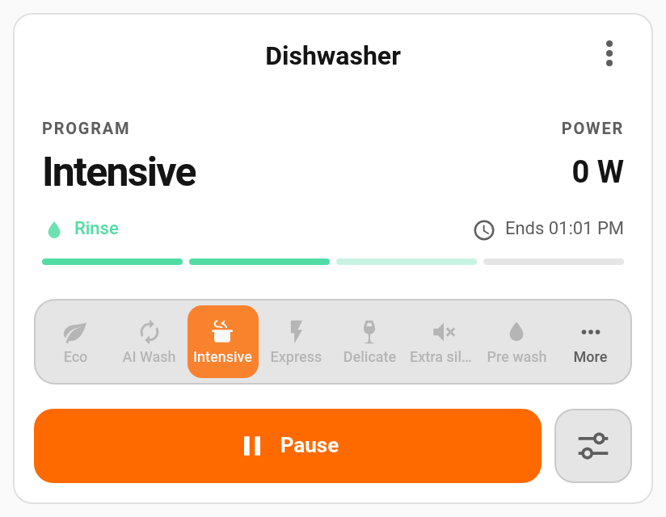
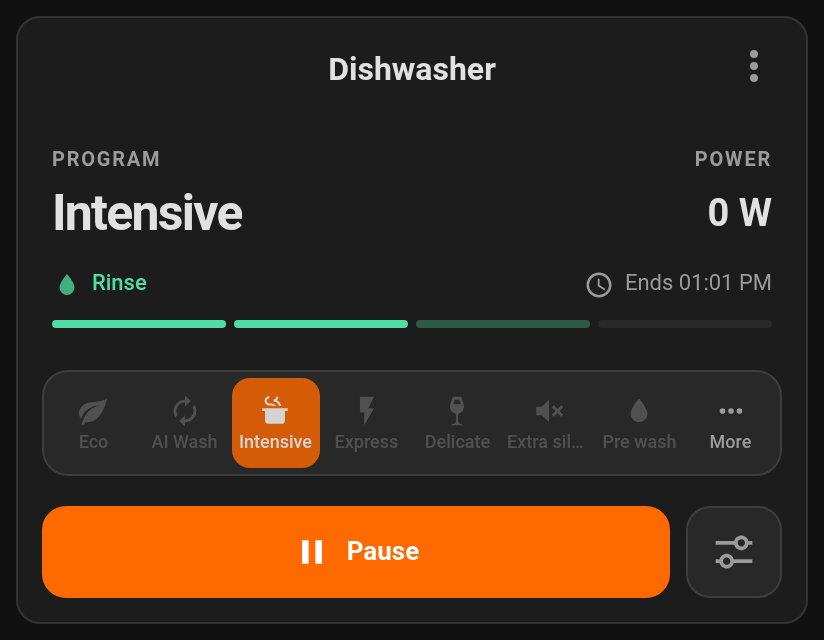
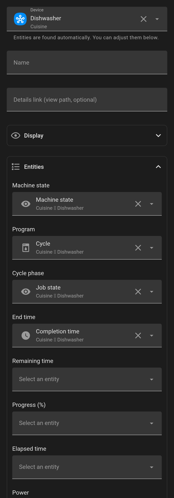

# Dishwasher Card

A Home Assistant dashboard card for dishwashers: status, program selector,
cycle phase and progress, end time, start / pause / resume, and delayed start.
It looks and behaves like Home Assistant's own cards, follows your theme and
speaks your language.

<p align="center">
  
  
</p>

## Features

- **Pick the device, done.** Choose your dishwasher in the card editor: its
  entities are found automatically (state, program, phase, end time, buttons,
  delayed start…). You can still change any of them.
- **Program selector** with icons, built from the program list of your
  dishwasher, named with Home Assistant's own translations. Pick which programs
  get a shortcut and in which order; the others stay one tap away under *More*.
- **Cycle phase and progress.** The current phase (pre-wash, wash, rinse,
  drying…) next to the end time, and a thin progress bar under it: a real
  percentage when your dishwasher reports one, otherwise four steps that fill as
  the cycle advances. A light sweep shows it is running; it stops when paused and
  respects the system's *reduce motion* setting.
- **Delayed start.** A clock next to *Start* opens a time picker; the card sets
  the delay and starts the program. While a delayed start is pending, the card
  shows when it starts (and ends) and the main button cancels it, with a
  confirmation.
- **Safe controls.** Commands are disabled when remote control is off, program
  changes are locked while a cycle runs, and missing buttons are simply hidden.
- **Visual editor** with Home Assistant's own pickers: device, entities, theme
  colours, icons, sliders. No YAML needed.
- **Translations:** English, French, German, Dutch, Spanish, Italian (every text
  can be overridden).

## Compatibility

The card only talks to Home Assistant entities, so it works with any
integration. Automatic discovery and the state names it understands were
written for:

| Integration | Discovery | Notes |
| --- | --- | --- |
| SmartThings (Samsung) | Tested | Delayed start needs Home Assistant with [core#190800](https://github.com/home-assistant/core/pull/190800) and [core#190897](https://github.com/home-assistant/core/pull/190897) (number *Delay start* + button *Start later*). |
| Home Connect (Bosch, Siemens, Neff, Gaggenau) | Designed for | Progress in %, finish time, pause / resume / stop. |
| Miele | Designed for | Program phase, remaining and elapsed time, start / pause / stop. |
| LG ThinQ | Designed for | Status, remaining time, delayed start countdown. |
| Anything else | Manual | Map the entities in the editor; unknown state values can be declared under *Advanced*. |

"Designed for" means the card was checked against those integrations' entity
names and states, not on a real appliance. Reports and screenshots are very
welcome.

Requires Home Assistant 2024.8 or newer.

## Installation

### HACS

[](https://my.home-assistant.io/redirect/hacs_repository/?owner=Sr-0w&repository=lovelace-dishwasher-card&category=plugin)

1. Open HACS, search for **Dishwasher Card** and download it.
   If it is not listed yet, add `https://github.com/Sr-0w/lovelace-dishwasher-card`
   as a custom repository of type **Dashboard** first.
2. Reload your browser.

### Manual

Copy `dist/dishwasher-card.js` to `config/www/`, then add `/local/dishwasher-card.js`
as a **JavaScript module** in **Settings → Dashboards → ⋮ → Resources**.

## Configuration



Add the card from the dashboard editor (search for *Dishwasher*) and pick your
dishwasher. That is all most people need.

In YAML, the shortest configuration is the device alone; entities you list
override what is found:

```yaml
type: custom:dishwasher-card
device: 7873171d347e90669f89458235d2c600
```

A fuller example:

```yaml
type: custom:dishwasher-card
name: Dishwasher
device: 7873171d347e90669f89458235d2c600
detail_path: /dashboard-home/dishwasher   # optional, opened by the ⋮ button
program_presets: [eco, ai, intensive, express, glasses, extra_silence, pre_wash]
program_short_labels:
  intensive: Intens.
colors:
  active: deep-orange       # a theme colour name, #hex or var(--…)
show_water: true
```

See the [configuration reference](docs/configuration.md) for every option.

## Privacy and permissions

The card runs in your browser and only uses Home Assistant's own API, with the
permissions of the logged-in user. No network requests, no tracking.

## License

MIT
