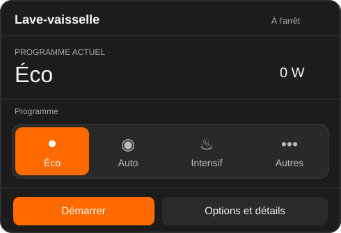

# Dishwasher Card for Home Assistant

A compact, device-agnostic Lovelace card with a program/status dial, cycle state, current power, estimated completion, remote availability, and a context-aware **Start / Pause / Resume** button.

**Status: 0.1.0 development prototype.** Tested with simulated device states, but **installed for live Home Assistant testing, but visual/device-level testing is still pending**. Do not publish a stable release before testing on real hardware.



## Install (development branch)

1. In **HACS / Marketplace**, add this repository as a **custom Dashboard repository**:
   `https://github.com/Sr-0w/lovelace-dishwasher-card`
2. Install **Dishwasher Card**, then reload Home Assistant.
3. If the resource was not registered automatically, add `/hacsfiles/lovelace-dishwasher-card/dishwasher-card.js` as a **JavaScript module** in **Settings → Dashboards → Resources**.
4. Add a **Manual** dashboard card.

## Example

```yaml
type: custom:dishwasher-card
name: Lave-vaisselle
detail_path: /dashboard-maison/cuisine-lave-vaisselle
entities:
  state: sensor.my_dishwasher_state
  program: select.my_dishwasher_program
  completion: sensor.my_dishwasher_completion_time
  power: sensor.my_dishwasher_power
  water: sensor.my_dishwasher_water_consumption
  remote: binary_sensor.my_dishwasher_remote_control
  start: button.my_dishwasher_start
  pause: button.my_dishwasher_pause
  resume: button.my_dishwasher_resume
program_labels:
  eco: Éco
  ai: Auto
  intensive: Intensif
  glasses: Verres
  express: Express
  pre_wash: Prélavage
  extra_silence: Silencieux
labels:
  idle: À l'arrêt
  running: En cours
  paused: En pause
  unavailable: Indisponible
  program: Programme
  remote_on: Commande distante active
  remote_off: Commande distante désactivée
  start: Démarrer
  pause: Pause
  resume: Reprendre
  details: Options et détails
  finish: Fin
```

The card uses a **native-looking segmented program selector**, without an appliance illustration or circular progress dial. The default visible program shortcuts are **Eco**, **Auto** (`ai`) and **Intensive**. The active choice has an orange background. **Other** opens Home Assistant's entity dialog for any of the other supported cycles. Only supported choices from the `select.*` entity's `options` attribute are shown. Changing a program invokes `select.select_option` and is disabled while a cycle is running.

Use `program_presets` to change the visible shortcuts, and optionally `program_icons` to provide MDI icons (e.g. `eco: mdi:leaf`). Both are device-agnostic. For example:

```yaml
program_presets:
  - eco
  - ai
  - intensive
program_icons:
  eco: mdi:leaf
  ai: mdi:autorenew
  intensive: mdi:fire
```

Required entity mappings: `state` and `program`. All others are optional. The state entity supports `run`, `running`, `pause`, `paused`, `stop`, `idle` and other common values.

Remote commands **require** button entities for `start`, `pause`, and `resume`. If the optional `remote` binary sensor is configured, commands are disabled unless it is `on`. Some appliances require remote control to be activated physically on the device before commands become available. No attempt is made to bypass that.

`power` is displayed in watts, `water` is the **cumulative** water reading (not one-cycle consumption), and `completion` expects an ISO-8601 timestamp. The configurable `detail_path` opens an existing view, not one created by this card.

## Portability and safety

All entity IDs are user-configured. There is **no vendor-specific API**, no external backend, and no network request outside the Home Assistant card interface. Button actions call `hass.callService('button', 'press', ...)` under the HA user's permissions.

Only the primary context-aware command is shown on the card. Cancel/drain, program selection, zones, and sanitation belong in an optional advanced view.

## Planned before HACS catalog submission

- Test against multiple appliance integrations and unavailable/disconnected states
- GUI editor, translations, configurable state mapping
- Real-world action/error tests, responsive and accessibility tests
- Tagged releases and automated validation

MIT license. Contributions welcome.